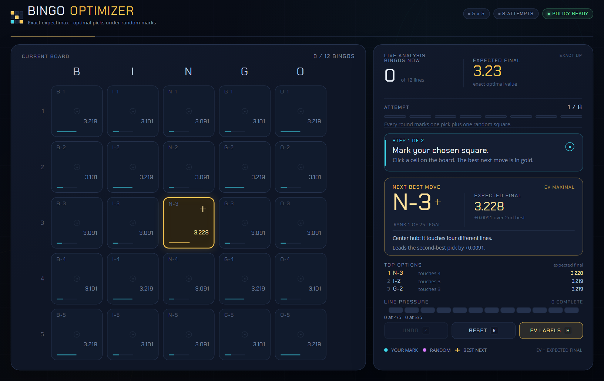

# Bingo Optimizer

Bingo calculator for Talesrunner written in Jai + raylib.

## Quick start

Download and extract the release.zip and run `BingoOptimizer.exe`.

NOTE: This app doesn't have a code-signing certificate, so you will see a warning 
when running the app the first time. Click on `More info`and click `Run anyway`
to start the application. 

## Web version (static)

Try the web version here: https://autols.github.io/TR_BingoOptimizer/



## How to use it

1. **Your pick** - click the square you intend to mark. It is stamped cyan and
   labelled `YOU`.
2. **Random mark** - click the square the game actually marked randomly. It is
   stamped magenta and labelled `RNG`. This consumes one of the 8 attempts.
3. The calculator immediately updates:
   - the **gold-bordered** square is the optimal next pick
   - every empty cell can show its **EV** (expected final bingo count)
   - `BEST NEXT MOVE` shows the recommended coordinate, its exact expected
     final bingos, and the edge over the second-best move
   - `TOP OPTIONS` lists the three best legal picks
   - `LINE PRESSURE` shows which of the 12 lines are complete, at 4/5, or at
     3/5.

NOTE: The game's random square is an observation you record, not something the
calculator decides for you. The app deliberately does not auto-roll during
normal use.

## Algorithm 

Let `S` be the 25-bit set of marked cells. Let `L(S)` be the number of complete
lines in `S`. Define `V_k(S)` as the optimal expected final bingo count when
`S` has `k` marked cells and `8 - k/2` rounds remain.

```
V_16(S) = L(S)

V_k(S)  = max over p not in S of
            1/(24-k) * sum over q not in S, q != p of
              V_{k+2}(S + p + q)
```

The inner sum is the exact expectation over the game's uniformly random mark.
The outer max is the player's optimal decision. The recurrence is evaluated
bottom-up for every even-sized mask from 16 marks down to the empty board.

Implementation details:

- `V` is stored in a direct `2^25`-entry `float` table, indexed by the bitmask.
  A second scratch table accumulates the 24-way random expectations for each
  odd-sized state. Both tables together are about 256 MiB during startup; the
  scratch half is released once the policy is built.
- Only even-sized masks are decision states: `sum(C(25,k), k even <= 16) =
  16,241,061` states. The full precomputation takes about **0.63 s** in the
  optimized build on this machine, once per launch.
- Ties are frequent because of board symmetry. If two moves differ by less than
  `0.000002` expected bingos, the UI breaks the tie for legibility (immediate
  lines, then 4/5 threats, then lines touched, then distance from center). This
  cannot materially change the expected score.
- Exact opening value from an empty board: **3.227864 expected final bingos**.
  The optimal opening square is the center (`N-3` in this board's
  column-letter/row-number coordinates).

This is the strongest general algorithm for this problem under the stated
objective: because every future random result is observed before the next
decision, the dynamic program yields the true optimal action at every
reachable state, not an approximation.

Test results:

- `solver_check`: `V(empty) = 3.227864`; best opening is the center; Bellman
  consistency held on 500 sampled states with worst error `0`; 20,000-game
  Monte Carlo returned `3.2236` bingos/game, consistent with the exact value.

## Credits and licences

- [raylib](https://www.raylib.com/) 6.0, zlib licence. The local copy includes
  the raylib licence and patch notes.
- **Chakra Petch** font, Copyright 2018 The Chakra Petch Project Authors, SIL
  Open Font License 1.1. See
  `assets/fonts/ChakraPetch-LICENSE.txt`.
- **Open Sans** font, Apache License 2.0. See
  `assets/fonts/OpenSans-LICENSE.txt`.
